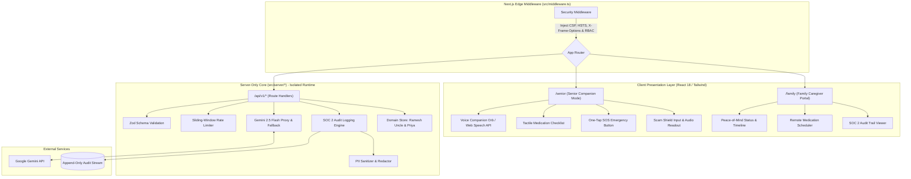

# Saathi (साथी) — AI Companion & Family Care Platform for Ageing Parents

> **Product Philosophy:** Independence for the older adult, peace of mind for the family.  
> **Market:** India-first, global-ready  
> **Version:** 1.0 (Next.js Fullstack Architecture & SOC 2 Compliant)

---

## 1. Executive Summary

**Saathi** is an AI-powered companion and family care ecosystem designed to address the deep generational and geographical divide between ageing parents living independently (in India and globally) and their adult children working in metros or abroad.

The platform provides an asymmetric, dual-persona experience:
1. **Senior Companion View (`/senior`)**: Tactile, oversized, high-contrast, voice-first companion interface supporting Hindi, English, and Hinglish. Eliminates tech friction while mitigating loneliness, ensuring medication adherence, and guarding against fraud.
2. **Family Caregiver Portal (`/family`)**: Data-driven peace-of-mind dashboard for adult children providing real-time activity timelines, prescription adherence tracking, emergency SOS alerts, and remote routine management.
3. **Scam & Fraud Shield (`/scam`)**: An AI utility that decodes suspicious WhatsApp forwards, bank SMS alerts, fake electricity disconnection threats, and malicious UPI links, providing simple vernacular risk explanations and actionable advice.

---

## 2. Product Roadmap & Phased Scope

```mermaid
graph LR
    subgraph MVP ["Phase 1: Expanded MVP (Current Scope)"]
        A[Empathetic Voice Companion]
        B[Daily Routine & Meds Adherence]
        C[One-Tap SOS & Emergency Siren]
        D[Family Peace-of-Mind Dashboard]
        E[Scam & Suspicious Message Shield]
    end
    
    subgraph Phase2 ["Phase 2: Safety & Utility"]
        F[WhatsApp Bot Integration]
        G[Gentle Mobility & Diet Suggestions]
        H[Paid Caregiver Coordination Logs]
    end
    
    subgraph Phase3 ["Phase 3: Connection & Legacy"]
        I[Life-Story / Voice Memoir Recorder]
        J[Senior Mentorship & Purpose Circle]
        K[Doctor Teleconsult Integration]
    end
    
    MVP --> Phase2 --> Phase3
```



### Phase 1: Expanded MVP Scope Details
* **Empathetic Voice Companion**: Warm, respectful conversational partner utilizing respectful honorifics (*Aap*, *Ji*), emotional check-ins, weather banter, and nostalgic memories.
* **Routine & Medication Adherence**: Morning, afternoon, and night card schedule with giant "Maine Le Li" (Taken) button, celebratory feedback, and instant family timeline dispatch.
* **One-Tap SOS Escalation**: High-visibility emergency trigger with accidental touch prevention (countdown timer), loud on-device alarm chime, and real-time push to the family dashboard.
* **Scam & Suspicious Message Checker**: Analyzes deceptive texts (e.g., electricity cut-offs, fake lottery/KBC, APK download links) and provides clear warnings in both Hindi and English.
* **Family Peace-of-Mind Dashboard**: Instant reassurance metrics (*"Papa's day is going well • 2 of 3 meds taken • Active 14m ago"*), live activity feed, and prescription editor.

---

## 3. System Architecture

Saathi is structured as a unified **Next.js (App Router)** application enforcing a strict boundary between client-side rendering and server-side compliance operations.



---

## 4. SOC 2 Type II Compliance Framework

Saathi is engineered from day one to fulfill the AICPA Trust Services Criteria (TSC) for healthcare and family data:

| Trust Criteria | Category | Saathi Architectural Control |
| :--- | :--- | :--- |
| **CC6.1** | **Logical Access** | Role-Based Access Control (`senior` vs `caregiver` vs `emergency_contact`) enforced in server route handlers and `middleware.ts`. |
| **CC6.6** | **Defense in Depth** | Strict HTTP security headers: `Content-Security-Policy`, `Strict-Transport-Security`, `X-Content-Type-Options: nosniff`, `X-Frame-Options: DENY`. |
| **CC6.7** | **Transmission & Secrets** | `GEMINI_API_KEY` is loaded exclusively within the server runtime using `import 'server-only'`. Zero API keys or secrets are exposed in browser bundles. |
| **CC6.8** | **Abuse & Injection** | Strict Zod schema validation on every API endpoint. Sliding-window IP/session rate limiters protect SOS and AI routes from denial of service. |
| **CC7.2** | **Audit Logging** | Append-only, tamper-resistant audit logger recording all data mutations (medication updates, SOS alarms, scam checks) with SHA-256 action hashes. |
| **Privacy** | **PII Protection** | Automated PII masking redacts phone numbers, email addresses, and personal health notes before writing to security audit logs. |

---

## 5. Repository Structure

```
elder/
├── README.md                            # Comprehensive product & architecture review plan
├── docs/
│   ├── ARCHITECTURE.md                  # Deep technical design specification
│   └── SOC2_COMPLIANCE.md               # SOC 2 Trust Services Criteria mapping
├── package.json                         # Next.js, React, Tailwind, Lucide, Zod
├── tsconfig.json                        # TypeScript configuration with @/* path aliases
├── next.config.mjs                      # Security headers & PWA configuration
├── tailwind.config.ts                   # Senior-accessible high-contrast design tokens
├── src/
│   ├── middleware.ts                    # Edge security middleware (CSP, HSTS, RBAC)
│   ├── types/
│   │   ├── care.ts                      # Medication, Routine, SeniorProfile, ActivityLog
│   │   ├── audit.ts                     # AuditEntry, PII levels, LogQuery
│   │   ├── scam.ts                      # ScamReport, RiskVerdict
│   │   └── api.ts                       # Standard API responses
│   ├── server/                          # Strict server-only core (isolated from client)
│   │   ├── audit/                       # SOC 2 CC7.2 Audit engine with SHA-256 hashes
│   │   ├── security/                    # Rate limiter, PII sanitizer, RBAC
│   │   ├── ai/                          # Gemini 2.5 Flash caller & scam detector
│   │   ├── db/                          # In-memory/persistent store seeded with Ramesh Uncle & Priya
│   │   └── schemas/                     # Zod input validation schemas
│   ├── app/                             # Next.js App Router
│   │   ├── layout.tsx                   # Root layout, fonts (Outfit & Inter), metadata
│   │   ├── page.tsx                     # Landing & Role Switcher
│   │   ├── senior/page.tsx              # Senior Companion Mode (PWA optimized)
│   │   ├── family/page.tsx              # Family Caregiver Portal
│   │   └── api/v1/                      # Versioned Route Handlers
│   │       ├── health/route.ts          # SOC 2 Uptime probe
│   │       ├── companion/converse/route.ts
│   │       ├── medications/route.ts
│   │       ├── medications/[id]/take/route.ts
│   │       ├── sos/trigger/route.ts
│   │       ├── sos/resolve/route.ts
│   │       ├── scam/analyze/route.ts
│   │       ├── family/summary/route.ts
│   │       └── audit-logs/route.ts
│   ├── client/                          # Client components & hooks
│   │   ├── components/
│   │   │   ├── senior/                  # VoiceOrb, MedChecklist, SosButton, ScamShield
│   │   │   ├── family/                  # Dashboard, Timeline, AdherenceBar, AuditViewer
│   │   │   └── common/                  # RoleHeader, AudioController, ToastProvider
│   │   ├── hooks/                       # Web Speech STT/TTS & synthesized chimes
│   │   └── services/                    # Typed API client
│   └── styles/
│       └── globals.css                  # Senior high-contrast tokens & fluid animations
```

---

## 6. Review Plan & Verification Checklist

### Pre-Implementation Architectural Sign-off
- [x] Product requirements aligned with PRD (Senior Companion + Family Portal + Scam Shield).
- [x] Decoupled client-server model consolidated into Next.js App Router with strict server runtime isolation.
- [x] SOC 2 Type II compliance controls mapped across CC6.1, CC6.6, CC6.7, CC6.8, CC7.2, and Privacy.

### Verification Checklist (During Execution)

#### 1. Security & Compliance Verification
- [ ] **Security Headers Test**: Query `GET /api/v1/health` with `curl -I` and confirm `Content-Security-Policy`, `Strict-Transport-Security`, `X-Frame-Options: DENY`, and `X-Content-Type-Options: nosniff`.
- [ ] **Rate Limiting Test**: Send rapid requests to `/api/v1/sos/trigger` and verify that `429 Too Many Requests` is returned once the threshold is exceeded.
- [ ] **PII Redaction Audit**: Verify that submitted phone numbers and personal messages are masked (e.g. `+91 98*** ***10`) in the `/api/v1/audit-logs` feed.

#### 2. Senior Companion View (`/senior`)
- [ ] **Voice Interaction**: Test microphone input; verify that speech is transcribed and empathetic voice response is played back in respectful Hindi/English.
- [ ] **Medication Adherence**: Tap "Maine Le Li" on a scheduled morning medicine; verify celebratory feedback, audio chime, and instant status update.
- [ ] **Emergency SOS**: Trigger the SOS button; verify 5-second countdown to cancel, audible siren, and dispatch to family dashboard.
- [ ] **Scam Shield**: Submit a suspicious electricity cut-off SMS; verify that the system flags it as HIGH RISK with actionable guidance in Hindi and English.

#### 3. Family Caregiver Portal (`/family`)
- [ ] **Peace-of-Mind Summary**: Verify parent's daily progress (*"2 of 3 meds taken • Morning check-in completed"*).
- [ ] **Live Activity Feed**: Confirm that medication events, companion chats, and scam checks appear on the timeline with timestamps.
- [ ] **Prescription Manager**: Add/edit a medication schedule and verify update reflects immediately on the senior view.
- [ ] **Audit Trail Viewer**: Inspect the live SOC 2 audit log to ensure all user actions are permanently logged.

---

## 7. Pre-Seeded Demonstration Persona

To enable instant out-of-the-box demonstration without complex manual setup, Saathi comes pre-seeded with:

* **Senior User**: Ramesh Sharma (73 years old, retired school principal, living in Janakpuri, New Delhi). Enjoys morning walks, retro Kishore Kumar songs, managing mild hypertension.
* **Primary Caregiver**: Priya Sharma (34 years old, product lead, living in Indiranagar, Bangalore). Monitors Ramesh's routine and medication adherence remotely.
* **Pre-loaded Schedule**:
  - *8:00 AM*: Morning Blood Pressure Tablet (Amlodipine 5mg) — Nashte ke baad.
  - *1:30 PM*: Multivitamin & Calcium — Lunch ke baad.
  - *8:30 PM*: Evening Walk & Night Tablet — Dinner ke baad.
